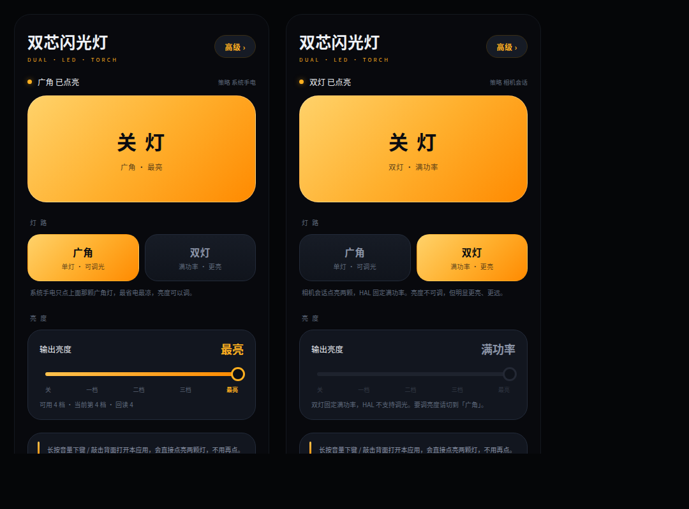
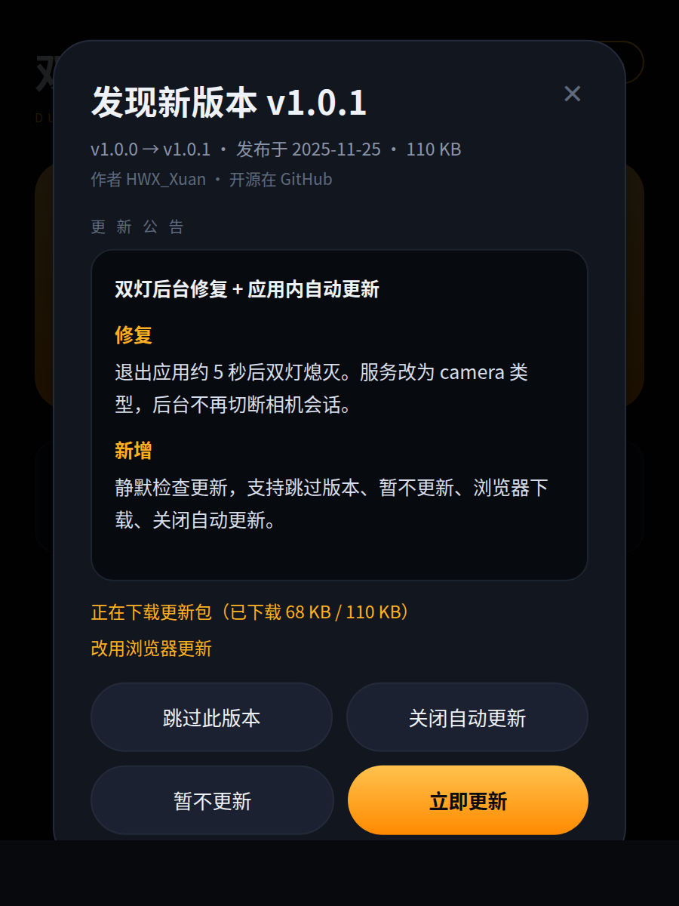

<div align="center">

# DualTorch for vivo

**Turn on both LEDs of a dual-flash phone at once — and really adjust the brightness.**

### **[Read this README in Chinese (简体中文版)](./README.md)**

</div>

---

> **Language / 语言:** English · **[简体中文](./README.md)**
> **Calibrated on:** vivo X300 Ultra (V2547A) · **Version:** v1.0.1 · **Android:** 10+ (API 29) · **Root:** not required
>
> This project was developed almost entirely by DeepSeek V4.1 Flash; this README was adapted from the free Hy4 flash, with oversight by 能工智人. Thanks also to WorkBuddy for the free eggs.



The stock torch on a dual-LED phone only drives the main-camera LED. DualTorch opens a Camera2 session to light up both LEDs, and adds Quick Settings tiles, launch shortcuts, and genuine hardware brightness levels on the single-LED mode.

---

## Quick navigation

| I want to… | Jump to |
| --- | --- |
| Install it right now | [1. Installation](#1-installation) |
| Know which button does what | [2. How to use](#2-how-to-use) |
| Get automatic updates / stop update prompts | [3. In-app updates](#3-in-app-updates) |
| Check whether my phone supports it | [4. If it doesn't work: self-test — do both LEDs light up?](#4-if-it-doesnt-work-self-test--do-both-leds-light-up) · [5. Compatibility](#5-compatibility) |
| Fix "brightness won't change" | [6. Known limitations & FAQ](#6-known-limitations--faq) |
| Build it from source | [7. Build from source](#7-build-from-source) |

---

## 1. Installation

### 1.1 Download the APK

| Source | Notes |
| --- | --- |
| **GitHub Releases (recommended)** | Open this repository's Releases page and download `DualTorch-v1.0.1.apk`. **Do not** download `Source code (zip)` — that is the source tree, not an installer. |
| Build it yourself | Follow [7. Build from source](#7-build-from-source); the APK is written to the repository root. |

> The installer is not distributed through Git (`dist/` is not version-controlled). Get it from Releases or build it.

### 1.2 Installing on your phone

1. **Get the APK onto the phone** — copy it to internal storage over USB, send it to yourself in a chat app, or download it from Releases directly on the device.
2. Tap the APK to install. When Android blocks it, open Settings from the prompt and enable **"Install unknown apps"** for the browser or file manager you used, then tap install again.
3. **Open DualTorch and grant two permissions:**
   - **Camera** — required for the dual-LED mode; the app opens a camera session but never captures photos or video.
   - **Notifications** — the foreground-service notification keeps the light alive when you leave the app or lock the screen.
4. **Tap the large button** in the middle of the main screen. The default preset is the single wide-angle LED; switch to "Dual" to light up both.

### 1.3 Upgrading, reinstalling and signatures

- New versions from Releases install over older ones (same signing key), so no uninstall is needed. **v1.0.1 uses the same signature as v1.0.0 and can be installed directly over it.**
- **A build you compile yourself has a different signature** and cannot overwrite the Releases build. Uninstall it first, or stick to your own builds from then on.
- The first build generates a key at `vivo-dual-torch/debug.keystore`. **Back it up**: all later builds must use the same key to overwrite earlier ones, or you will have to uninstall and reinstall.
- If you get "signature conflict / app not installed", the two versions were signed differently — uninstall the old one first.
- The Releases APK uses the project's test signing key and is intended for personal use and testing. For wider distribution, generate your own release keystore, store it offline, and use it for every subsequent release. Never commit the key or upload it as a release asset.

---

## 2. How to use

### 2.1 Main screen

| Action | Result |
| --- | --- |
| Tap the large center button | Turn the light on / off, using the last selected light path and level |
| Select **Wide** | Only the upper LED lights up; brightness is adjustable, lowest power and heat; defaults to the highest level |
| Select **Dual** | Both LEDs at full power; the brightness slider is disabled (in-session dimming currently has no effect with this setup) |
| Drag the brightness slider | Only works in Wide mode. Levels are generated from the hardware (4 usable levels on the calibrated device); dragging to the far left turns the light off |

### 2.2 Quick Settings tiles

In the notification shade, go to **Edit → Add → app shortcuts under Atomic Controls** to add these two tiles:

| Tile | What it does |
| --- | --- |
| **双芯闪光灯** (DualTorch) | Tap to turn on, tap again to turn off — restores the last light path and level |
| **手电灯路** (Light path) | Cycles between Wide (single LED) and Dual (both LEDs) |

### 2.3 Notification

A low-priority persistent notification lets you turn the light off, switch the light path, or change brightness without opening the app.

### 2.4 Home-screen shortcuts

Long-press the app icon to see four shortcuts: **Toggle**, **Switch light path**, **Switch brightness**, and **Turn off**.

### 2.5 Quick launch (no app opening required)

On vivo: **Settings → Shortcuts and accessibility → Quick launch**. You can map **long-press volume down** or **double/triple-tap the back** to open DualTorch. When triggered from the lock screen or by tapping the back, the app starts the dual-LED mode directly.

If you don't want this behaviour, open the app's **Advanced** screen and disable "auto-on at launch".

---

## 3. In-app updates

Since v1.0.1, the app silently checks GitHub Releases about 3.5 seconds after launch, no more than once every 6 hours. When a new version is found, a dialog shows the version number, publish date, APK size and release notes:



| Button | Behaviour |
| --- | --- |
| Update now | Downloads the APK in-app (with progress), then launches the system installer |
| Use browser | Opens the Release page for a manual download |
| Skip this version | Remembers that version so it won't be shown again |
| Not now | Closes the dialog for this session; it will prompt again next launch |
| Disable auto-update | Stops automatic checks; re-enable under **Advanced → About & update** |

**Advanced → About & update** shows the current version and the auto-update switch, plus a manual **Check for updates** button. On your first in-app update Android will ask you to allow "Install unknown apps" for DualTorch; grant it, go back, and tap "Update now / Install" again — the APK is already downloaded and won't be fetched twice.

This feature uses only two permissions: `INTERNET` (query `api.github.com` and download the APK from GitHub Releases) and `REQUEST_INSTALL_PACKAGES` (launch the system installer). See [Privacy](#6-known-limitations--faq).

---

## 4. If it doesn't work: self-test — do both LEDs light up?

Run this once after installing:

1. Open the app, switch to **Dual**, and look at the back of the phone. Both LEDs should be on and the beam noticeably wider.
2. If only one LED lights up, this phone's HAL does not drive both LEDs by focal length. The Dual mode won't work here; use Wide as a normal torch. Everything else stays functional.
3. If both light up, the full feature set is available. Switch back to **Wide** and drag the slider to confirm brightness really changes.
4. For deeper diagnostics (camera list, level readback, vendor keys), use the **Hardware probe** and **Self-test** pages.

---

## 5. Compatibility

| Device | Status |
| --- | --- |
| **vivo X300 Ultra (V2547A)** | Full support — dual LEDs, 4 brightness levels, tiles and shortcuts all calibrated on this device |
| Other vivo dual-LED phones | Likely works (same HAL focal-length logic); test the level count using [§4](#4-if-it-doesnt-work-self-test--do-both-leds-light-up) |
| Other brands with dual LEDs | Only the system-torch path is guaranteed; dual LEDs depend on whether the vendor HAL switches LEDs by focal length |
| Single-LED phones | No second LED to drive — works as a regular torch only |

> `V2547A` is the model number vivo lists for the **X300 Ultra** on its official site. Other vivo dual-LED models worth trying include the vivo X200 Ultra, X300, X300 Pro, S50 Pro mini, X300s, X300 Ultra, X500, X500 Pro, X500 Pro Max, and X300 FE.

---

## 6. Known limitations & FAQ

| Symptom | Explanation / fix |
| --- | --- |
| The slider does nothing in Dual mode | By design. `FLASH_STRENGTH_LEVEL` is ignored by this HAL inside a camera session. Use Wide mode to adjust brightness. |
| The light flickers once when changing level | Some HALs ignore level increases while the torch is already on. The app reads the level back and, if it doesn't match, cycles the torch off and on. This is a fallback, not a fault. |
| Switching from Dual back to Wide takes a moment | The system torch and the camera session cannot own the camera at the same time; the session must release first. Usually under 200 ms, up to ~1.2 s in the worst case. The status line shows "switching…". |
| Why only 4 brightness levels? | The calibrated device declares 5, but the torch path rejects the highest one (it falls back to level-2 brightness). The usable maximum is `declared − 1`; the slider always matches what the hardware accepts. |
| The phone gets hot in Dual mode | Both LEDs run at full power. Avoid continuous use for more than a few minutes. |
| The dual LEDs turn off after leaving the app | Fixed in v1.0.1: the foreground service is now declared `camera\|specialUse` so Android won't cut off camera access in the background. If it still happens, set the app to "unrestricted / allow background activity" in the system battery settings — that is a ROM policy. |
| "Signature conflict" during install | The two versions were signed differently (common between a Releases build and a self-compiled one) — see [1.3](#13-upgrading-reinstalling-and-signatures). |

**Safety**

- Do not shine the light into anyone's (or any pet's) eyes; full-power dual LEDs at close range can cause discomfort or injury.
- Do not leave it on against fabric, paper, or other flammable material.
- The app does not throttle itself at high ambient temperatures — keep an eye on the device temperature.

**Privacy**

- Uses two permissions: `INTERNET` (only to query `api.github.com` for update checks and download the APK from GitHub Releases) and `REQUEST_INSTALL_PACKAGES` (only to launch the system installer). **No analytics, no account system, no data collection or upload.**
- Settings are stored only in local `SharedPreferences`.
- The camera permission is used solely to drive the flash; no frames are captured or saved.

---

## 7. Build from source

No Gradle required — only the Android SDK (build-tools 35 + platform 35) and a JDK. Below, `<repo>` means the repository root.

- Sources: `<repo>/vivo-dual-torch/`
- Build script: `<repo>/vivo-dual-torch/build-apk.sh`

### 7.1 Linux / macOS

```bash
export ANDROID_HOME=/path/to/android-sdk
cd <repo>/vivo-dual-torch
bash build-apk.sh ../DualTorch-v1.0.1.apk
```

### 7.2 Windows (Git Bash)

```bash
export ANDROID_HOME=/c/Users/<your-user>/AppData/Local/Android/Sdk   # change to your actual SDK path
cd /c/path/to/DualTorch-repo/vivo-dual-torch
bash build-apk.sh ../DualTorch-v1.0.1.apk
```

The script runs `aapt2 → javac → d8 → zipalign → apksigner`. Without an output argument it writes `DualTorch-v1.0.apk` to the repository root.

> The first build generates a **new** key at `vivo-dual-torch/debug.keystore`, which cannot overwrite a Releases installation. Back it up — otherwise your own future builds cannot overwrite your earlier ones either. See [1.3](#13-upgrading-reinstalling-and-signatures).

### 7.3 Source layout

```
vivo-dual-torch/app/src/main/java/com/dualtorch/app/
├── MainActivity.java            main UI: light path + hardware level slider
├── AdvancedActivity.java        advanced options: strategy, system entries, about & update
├── TorchService.java            foreground service: state holder (`camera|specialUse`)
├── TorchTileService.java        Quick Settings tile: on / off
├── LedTileService.java          Quick Settings tile: light path
├── BaseCmdTile.java             Quick Settings tile base
├── ShortcutActivity.java        headless command entry point
├── UpdateDialog.java            update dialog and download
├── ApkProvider.java             safely shares the downloaded APK with the installer
├── core/
│   ├── TorchController.java     dispatcher: path switching, throttling, session generation
│   ├── SystemTorchEngine.java   system torch and hardware levels
│   ├── CameraSessionEngine.java camera session (dual LEDs)
│   ├── UpdateChecker.java       GitHub Releases check and download
│   ├── Prefs.java               single source of truth for state
│   └── RootEngine.java          optional: direct LED node writes (root)
└── res/                         layouts, theme, icons
```

For the engineering background and debugging notes, see [the technical write-up](docs/技术方案.html).

---

## Language

- **[简体中文版 README](./README.md)**
- English (current document)

---

## Back to Chinese

### **[简体中文版 README · Click here to switch back](./README.md)**

---

## License

[MIT](LICENSE)
