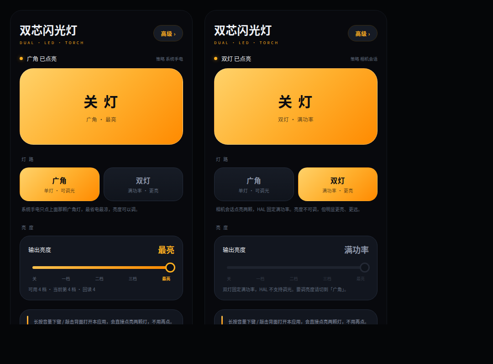

# 双芯闪光灯 · DualTorch

**让 vivo 双 LED 机型的两颗闪光灯同时点亮，并且能真正按硬件档位调光。**

系统手电只肯点亮主摄那一颗；这个 App 用相机会话把两颗一起拉起来，再补上控制中心磁贴、快捷手势和真正有效的亮度档位。



> 为 vivo V2547A（X200 Pro）实测校准。其它机型请先看[兼容性](#兼容性)。

---

## 目录

- [为什么需要它](#为什么需要它)
- [功能](#功能)
- [兼容性](#兼容性)
- [安装](#安装)
- [使用](#使用)
- [工作原理](#工作原理)
- [构建](#构建)
- [已知限制](#已知限制)
- [安全提醒](#安全提醒)
- [隐私](#隐私)
- [English](#english)

---

## 为什么需要它

大部分双 LED 手机的系统手电只驱动主摄那一颗，另一颗只在拍照闪光时参与。厂商没有开放「两颗一起常亮」的开关，第三方应用用 `CameraManager.setTorchMode()` 也只能拿到同一颗。

Android 的相机 HAL 在**相机会话**里按焦段决定点几颗灯：主摄拉到 2× 及以上时，vivo 的 HAL 会同时驱动两颗 LED。这个行为没有文档，是实测出来的。DualTorch 就是把这套行为包装成一个正常的手电应用。

顺带解决另一个问题：`turnOnTorchWithStrengthLevel()` 在部分 HAL 上会**静默忽略**升档请求——滑到最右，界面显示「最亮」，实际亮度还停在二档。App 会回读校验，不符就关掉重开一次，让档位真的落到驱动电流上。

## 功能

| 功能 | 说明 |
|---|---|
| **双灯常亮** | 相机会话 + 2× 焦段，两颗 LED 同时满功率 |
| **单灯可调光** | 广角档走系统手电，档位直接对应 HAL 的 strength level |
| **硬件档位对齐** | 读 `FLASH_TORCH_STRENGTH_MAX_LEVEL`，硬件有几档就生成几格，自动剔除 HAL 不认的最高档 |
| **控制中心磁贴** | 「双芯闪光灯」一键开/关双灯；「手电灯路」在广角/双灯间切换 |
| **快捷入口** | 配合系统「快捷启动」，长按音量下键或敲击背面，打开即双灯 |
| **常驻不灭** | 前台服务持有灯光，退出界面、锁屏都不影响 |
| **零网络权限** | 没有 `INTERNET`，不联网、不统计、不收集任何数据 |

## 兼容性

| 机型 | 状态 |
|---|---|
| **vivo V2547A（X200 Pro）** | ✅ 完整支持，所有档位与双灯逻辑均在此机型实测校准 |
| 其它 vivo 双 LED 机型 | ⚠️ 双灯大概率可用（同一套 HAL 逻辑），档位数量需自测 |
| 其它品牌双 LED 机型 | ⚠️ 仅保证系统手电通路可用，双灯取决于厂商是否按焦段驱动 |
| 单 LED 机型 | ❌ 没有双灯可开，只能当普通手电用 |

判断方法：装上后切到「双灯」，看是否两颗都亮、光斑是否变宽。不亮就是 HAL 不支持，不影响单灯功能。

## 安装

1. 到 [Releases](../../releases) 下载最新的 `DualTorch-x.y.z.apk`
2. 允许「安装未知来源应用」
3. 首次打开授予**相机权限**（双灯档必需）和**通知权限**（前台服务提示）

要求 **Android 10（API 29）及以上**。

- 从 4.x 测试版升级可直接覆盖，无需卸载（`versionCode` 沿用同一号段）。
- APK 使用项目自带测试签名，仅供自用与测试；如需长期分发，请自行生成并保管 release keystore。

## 使用

| 动作 | 结果 |
|---|---|
| 主按钮 | 开灯 / 关灯，沿用上次的灯路与档位 |
| 灯路：广角 | 只点上面那颗，亮度可调，最省电、发热最小 |
| 灯路：双灯 | 两颗全亮、满功率，滑条自动置灰（HAL 不支持会话内调光） |
| 滑条最左 | 关灯 |
| 控制中心「双芯闪光灯」 | 点一下开双灯，再点关灯 |
| 控制中心「手电灯路」 | 广角 ↔ 双灯 循环 |
| 通知栏 | 关灯 / 切灯路 / 调亮度 |

**快捷入口**：在系统设置里把「长按音量下键」或「双击背部」映射为打开本应用（vivo：设置 → 快捷与辅助 → 快捷启动）。App 冷启动时默认直接开双灯，可在「高级」里关闭。

## 工作原理

```
单灯  → CameraManager.setTorchMode(cameraId, true)
        CameraManager.turnOnTorchWithStrengthLevel(cameraId, level)

双灯  → Camera2 打开主摄，CONTROL_ZOOM_RATIO ≥ 2.0
        HAL 按焦段同时驱动两颗 LED，setFlashOn(true) 常亮
```

几个关键点：

- **档位不写死**：`FLASH_TORCH_STRENGTH_MAX_LEVEL` 上报几档就生成几格。实测这台机器声明 5 档，但最后一档 torch 通路不接受（请求后落回二档亮度），所以有效上限取「声明值 − 1」，默认停在真正的最高档。
- **回读校验**：设档后立刻 `getTorchStrengthLevel()` 回读；不符就关灯重开一次。部分 HAL 在灯已亮时忽略升档，这是唯一可靠的兜底。
- **通路互斥**：系统手电和相机会话会抢相机。切换时先 `cam.stop()`，轮询到相机真正释放再点灯，避免 `CAMERA_IN_USE`。
- **状态单一来源**：界面、磁贴、通知、快捷方式读写同一份 `Prefs`，命令统一进前台服务串行执行。

更细的踩坑记录在 [`docs/技术方案.html`](docs/技术方案.html)。

## 构建

不依赖 Gradle，只需要 Android SDK（build-tools 35 + platform 35）：

```bash
export ANDROID_HOME=/path/to/android-sdk
cd vivo-dual-torch
bash build-apk.sh ../DualTorch-1.0.0.apk
```

脚本会依次跑 `aapt2 → javac → d8 → zipalign → apksigner`。首次构建时若没有 `debug.keystore` 会自动生成一个——**请妥善保存**，否则后续版本无法覆盖安装。

源码结构：

```
vivo-dual-torch/app/src/main/java/com/dualtorch/app/
├── MainActivity.java            主界面：灯路 + 动态档位滑条
├── TorchService.java            前台服务：状态持有与命令队列
├── BaseCmdTile.java             控制中心磁贴骨架
├── ShortcutActivity.java        无界面命令入口
├── core/
│   ├── TorchController.java     调度中心：通路切换、节流、会话代次
│   ├── SystemTorchEngine.java   系统手电与硬件档位
│   ├── CameraSessionEngine.java 相机会话（双灯）
│   ├── Prefs.java               唯一状态源
│   └── RootEngine.java          可选：root 直写 LED 节点
└── res/                         布局、主题、图标
```

## 已知限制

- **双灯档不能调光**：相机会话里 `FLASH_STRENGTH_LEVEL` 被 HAL 忽略，是硬件限制。要调亮度请切「广角」。
- **升档可能闪一下**：HAL 忽略升档时 App 会关灯重开，属于兜底行为，不是故障。
- **双灯 → 广角需要等相机释放**：通常 200ms 内，极端情况约 1.2 秒，状态栏会显示「切换中 · 稍候」。
- **长时间双灯会明显发热**：两颗 LED 满功率，建议连续使用不超过几分钟。

## 安全提醒

- **不要直射眼睛**，包括人和宠物；双灯满功率近距离照射可能造成不适或损伤。
- 不要覆盖在织物、纸张等易燃物上长时间点亮。
- 高温环境下 App 不会主动降档，请自行留意机身温度。

## 隐私

- 没有 `INTERNET` 权限，无法联网。
- 不收集、不上传任何数据；所有设置只存在本机 `SharedPreferences`。
- 相机权限仅用于打开相机会话驱动闪光灯，不采集画面、不保存图像。

## English

**DualTorch** turns on both LEDs of a dual-flash vivo phone at once, something the stock torch toggle refuses to do.

The trick: Android's camera HAL drives both LEDs when a camera session is zoomed to 2× or beyond. DualTorch opens a Camera2 session, sets `CONTROL_ZOOM_RATIO ≥ 2.0`, and keeps the flash on. A separate system-torch path handles single-LED mode with real hardware strength levels.

- Calibrated on **vivo V2547A (X200 Pro)**; other vivo dual-LED models may work.
- Android 10+ (API 29), no root required.
- No network permission, no analytics, no data collection.
- MIT licensed. Build with `bash build-apk.sh` — no Gradle needed.

## License

[MIT](LICENSE)
